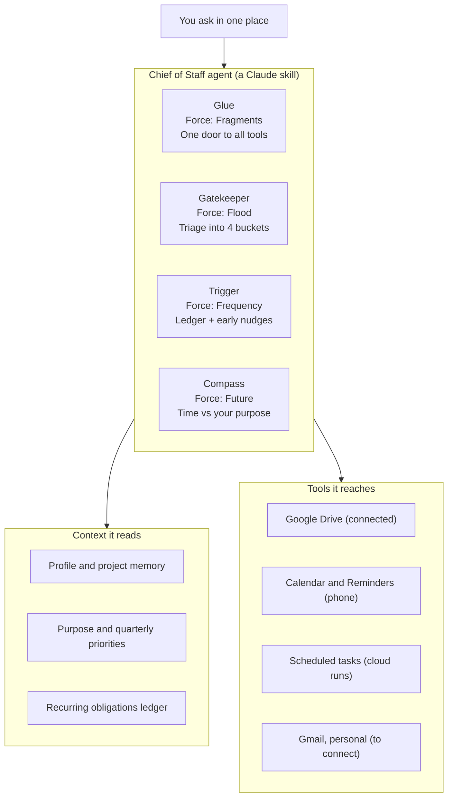

# Personal AI Agent — Concepts from "This ONE AI Agent"

Nov 5, 2026 · @Venkatesan

## Source

The framework comes from [This ONE AI Agent Will Make You So Productive It's Almost Unfair](https://www.youtube.com/watch?v=x9hrptrGGY0) by Sandeep Swadia (The MIT Monk), published Nov 4, 2026, roughly 16 minutes.

YouTube blocked transcript access, so this doc is built from the episode's published description and chapter outline. Where a section goes beyond that outline, it is marked as interpretation.

| Time | Chapter |
| --- | --- |
| 0:00 | AI agents are changing |
| 1:11 | Understanding personal agents |
| 2:52 | Fighting fragmentation |
| 7:02 | Managing information floods |
| 10:25 | Handling recurring frequency |
| 13:34 | Prioritizing your future |
| 15:25 | What are you doing with the time given to you? |

## The core idea: hire a Chief of Staff, not interns

One AI that knows you well beats ten that don't. Most people adopt AI by stacking apps, chatbots and subscriptions, then spend their day managing them. The video calls that hiring a crowd of AI interns when what you wanted was a Chief of Staff.

A personal agent is the opposite of app sprawl: one assistant that holds your context (who you are, what you're working on, what matters), can reach your tools, and acts on your behalf. Its value grows with how well it knows you, which is why consolidating beats collecting.

The video organizes the case around four forces that drain daily productivity. Each one maps to a role the agent plays.

| Force | What drains you | Agent's role |
| --- | --- | --- |
| Fragments | Toggling between apps \~1,200 times a day splits attention | Glue across your tools |
| Flood | A daily avalanche of messages eats cognitive bandwidth | Gatekeeper that filters noise |
| Frequency | Infrequent recurring tasks slip because there's no repetition to build habit | External trigger that automates and tracks |
| Future | Busy work crowds out what you actually care about | Compass that aligns time with purpose |

The closing argument: productivity only means something when it serves your purpose.

## Force 1 — Fragments: the agent as glue

Every app switch costs a little attention, and at \~1,200 toggles a day those costs fracture deep work. The fix is not fewer tools but one layer that sits across them.

The agent becomes the single front door: you ask it, it goes to calendar, files, notes or code and brings back an answer or does the step.

Recommendations (outline, with interpretation):

- Pick one home agent and route requests through it instead of opening each app.
- Connect it to the tools you already live in, so it can read and act rather than just advise.
- Give it a standing context file: your role, active projects, people, and preferences, so it never starts cold.
- Judge it by switches avoided, not features used.

## Force 2 — Flood: the agent as gatekeeper

The volume of daily communication, not its difficulty, is what exhausts you. The agent protects your bandwidth by reading first and letting through only what needs you.

Recommendations (outline, with interpretation):

- Have the agent triage incoming items into a few buckets: act now, decide, read later, ignore.
- Receive one digest at set times instead of a constant stream.
- Tell it explicitly what counts as signal for you (people, projects, deadlines) so its filter matches your priorities.
- Keep the final call yourself: the agent drafts and sorts, you decide and send.

## Force 3 — Frequency: the agent as external trigger

Daily tasks become habits; quarterly and yearly ones never get enough repetition to stick, so they fall through the cracks. The agent supplies the memory and the nudge you can't.

Recommendations (outline, with interpretation):

- Keep one ledger of recurring obligations with their cadence and lead time.
- Let scheduled runs fire the reminder early enough to act, not on the due date.
- Automate the prep (gather documents, draft the first version), not just the reminder.
- Track completion so the agent can tell you what's overdue and what's coming next.

## Force 4 — Future: the agent as compass

The first three forces save time; this one decides what the time is for. Productivity tools should be aligned with your true purpose, or they just help you do more of the wrong things faster.

Recommendations (outline, with interpretation):

- Write down your purpose and a few current priorities, and give them to the agent as standing context.
- Have it weigh requests and weekly plans against those priorities and say plainly when something doesn't fit.
- Run a short weekly review: where did the time go, and did it serve what matters?

The episode closes on one question worth putting at the top of every weekly review: what are you doing with the time given to you?

## Applying it: one Chief of Staff agent for you

The agent is a single Claude skill with four modes, one per force. It reads three context files and reaches four tools.

Guardrail: personal use only, no JPMorgan systems or firm data.

Gmail is marked "to connect" because it isn't connected yet; the gatekeeper needs it for real triage.

| Mode | How you call it | What it does | What you get |
| --- | --- | --- | --- |
| Glue | "cos, find or do X" | Routes to Drive, calendar, reminders or memory and acts | The answer or the finished step |
| Gatekeeper | "triage" or the morning brief | Sorts inbound items into Act, Decide, Read later, Ignore | One short digest |
| Trigger | "what's due" or a weekly scheduled run | Checks the ledger, nudges at lead time, preps the paperwork | Due-soon list plus phone reminders |
| Compass | "weekly review" or "should I take this on?" | Weighs time and requests against your purpose file | Keep, defer or drop, with the reason |

Why it fits you: you run a wide portfolio of side projects (TokenLens, the plugins kit, the foreclosure dashboard, TrendCast, the trading bot and more) next to a lead role. That's where Fragments and Future bite hardest, so the compass's first job is ranking those projects against your priorities.

The guardrail matters: this is a personal agent. Work email, Confluence and firm data stay out of it.

## Getting started: the first week

Start with context, then one force at a time, so the agent earns trust before it gets more reach.

- [ ] Day 1: Install the chief-of-staff skill and write your purpose plus three priorities for this quarter
- [ ] Day 2: Seed the recurring ledger with every quarterly and yearly obligation you can think of
- [ ] Day 3: Connect Gmail (personal) so the gatekeeper has an inbox to triage
- [ ] Day 4: Turn on the weekday morning brief as a scheduled task
- [ ] Day 5: Route every request through the agent for one full day and note which app switches it saved
- [ ] Day 7: Run the first weekly review and rank your side projects against your priorities
